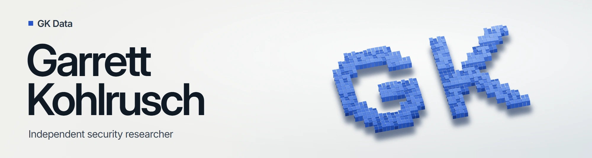
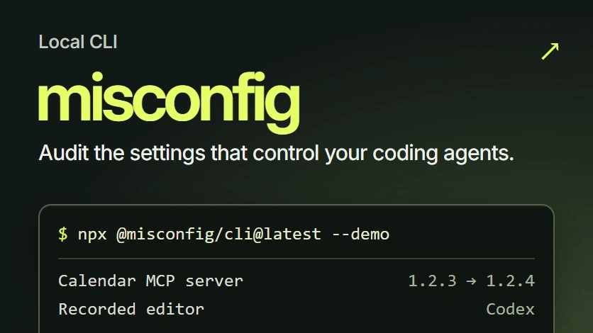
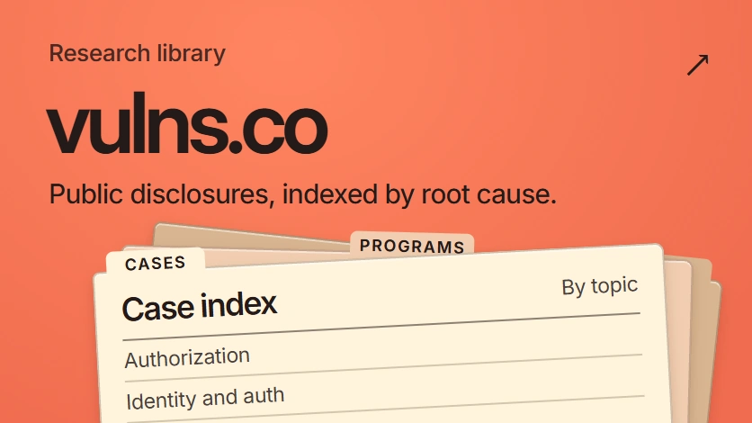
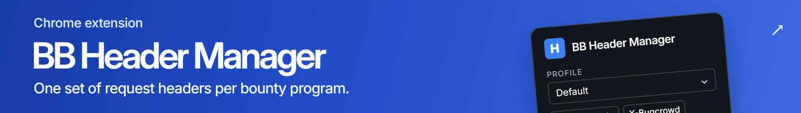

<h1>
  <a href="https://gkdata.io/"><picture>
      <source media="(max-width: 650px), (min-width: 768px) and (max-width: 979px)" srcset="assets/portfolio/garrett-mobile.webp">
      
  </picture></a>
</h1>

I test web apps and APIs at GK Data, the practice I founded in Blaine, Minnesota. I maintain the case archive at vulns.co and write the checks behind [misconfig.ai](https://misconfig.ai/).

## Selected work

  <a href="https://github.com/gkdataio/misconfig"><picture>
      <source media="(max-width: 650px), (min-width: 768px) and (max-width: 979px)" srcset="assets/portfolio/misconfig.webp" width="840">
      <source media="(max-width: 1279px)" srcset="assets/portfolio/misconfig-wide.webp" width="1200">
      
  </picture></a>
  <a href="https://vulns.co/"><picture>
      <source media="(max-width: 650px), (min-width: 768px) and (max-width: 979px)" srcset="assets/portfolio/vulns.webp" width="840">
      <source media="(max-width: 1279px)" srcset="assets/portfolio/vulns-wide.webp" width="1200">
      
  </picture></a>
  <a href="https://github.com/gkdataio/BB-Header-Manager"><picture>
      <source media="(max-width: 650px), (min-width: 768px) and (max-width: 979px)" srcset="assets/portfolio/header-manager-mobile.webp">
      
  </picture></a>

[Try the misconfig demo](https://github.com/gkdataio/misconfig#computer-review) · [Get the vulns.co data](https://vulns.co/research/data/) · [Install BB Header Manager](https://chromewebstore.google.com/detail/llpjjjjocdmaeknobpfdjojdamaplfii)

## Tools and datasets

- [Security Research Library](https://github.com/gkdataio/security-research-library) supplies the case and program data for vulns.co, with JSON exports, original diagrams, and links to the underlying reports.
- [GatePeek](https://github.com/gkdataio/GatePeek) brings DNS and HTTP results into one subdomain report and keeps links to matching GitHub sources.
- [applyzer](https://github.com/gkdataio/applyzer) identifies a site's frameworks and CMS, including version numbers when available. It can export the inventory as JSON or CSV.
- [Web Directory Inspector](https://github.com/gkdataio/Web-Directory-Inspector) compares HTTP status codes and response sizes across a list of paths.

## Experiments

- [Cryptic Image Messenger](https://github.com/gkdataio/Cryptic-Image-Messenger) turns text into grayscale pixels and back. This [encoded project list](assets/portfolio/project-list.png) sets the height and shade of the blue tiles in my header. Decode it with seed `763`.
- [Python pentesting for beginners](https://github.com/gkdataio/pythonpentestingbeginners) teaches networking and web security through interactive Python exercises.

---

[Work with me](https://gkdata.io/contact/) · [Published research](https://gkdata.io/research/) · [Bugcrowd](https://bugcrowd.com/h/GKData) · [LinkedIn](https://www.linkedin.com/in/kohlrusch/)
