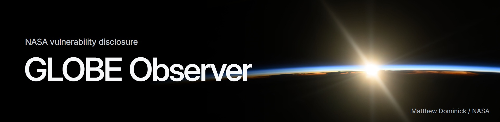

# Garrett Kohlrusch

I test web apps and the APIs behind them. I founded GK Data, an independent security practice in Blaine, Minnesota.

  <a href="https://gkdata.io/research/nasa-globe-observer-stored-xss/">
    <picture>
      <source media="(max-width: 600px)" srcset="assets/globe-observer-mobile.jpg">
      
    </picture>
  </a>

<!-- Cover photograph: https://www.nasa.gov/image-article/sunrise-begins/ -->

A comment I entered in the GLOBE Observer mobile app ran as JavaScript on the public observation page. NASA fixed the bug after I reported it. [Read the case study](https://gkdata.io/research/nasa-globe-observer-stored-xss/).

## Projects

### [misconfig](https://github.com/gkdataio/misconfig)

See which file lets Claude Code or Codex run commands without asking. The check runs locally and shows you the setting to change.

### [vulns.co](https://vulns.co/)

I index public bug bounty reports by root cause and link each one to the original disclosure. You can find the data and diagrams in the [Security Research Library](https://github.com/gkdataio/security-research-library).

---

[GK Data](https://gkdata.io/) · [Bugcrowd](https://bugcrowd.com/h/GKData) · [LinkedIn](https://www.linkedin.com/in/kohlrusch/) · [Email me](mailto:garrett@gkdata.io)
